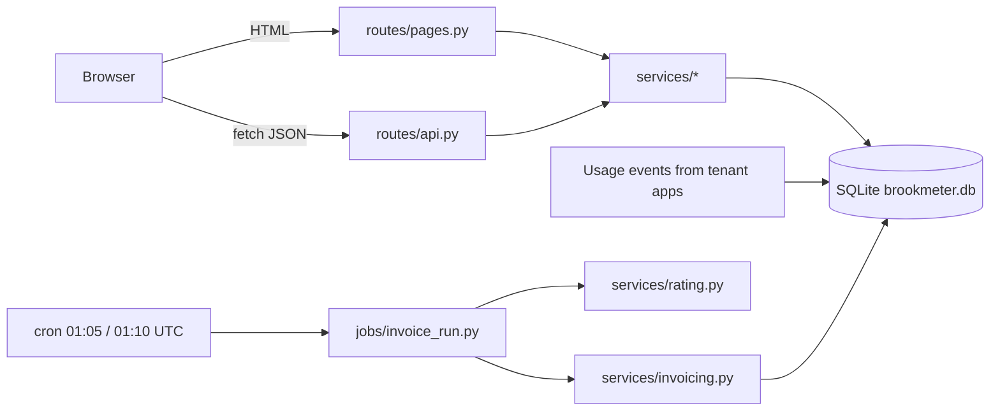
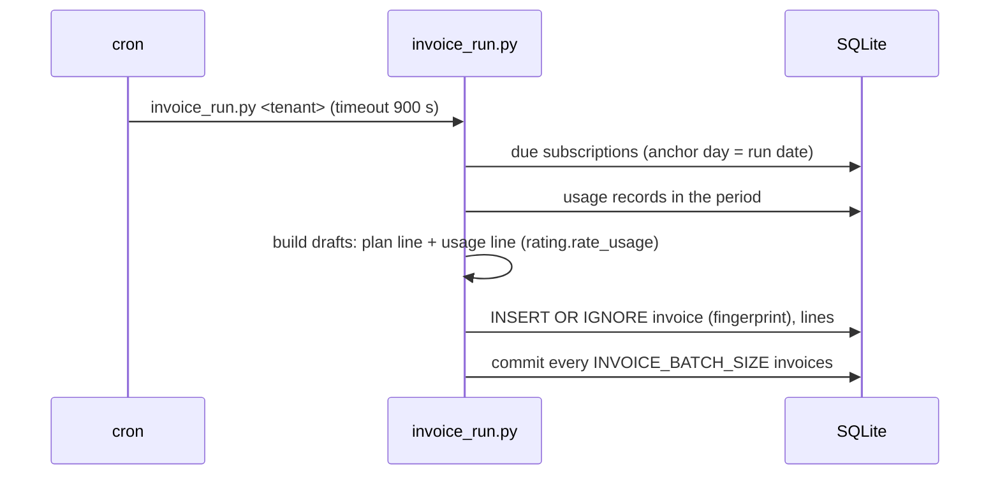
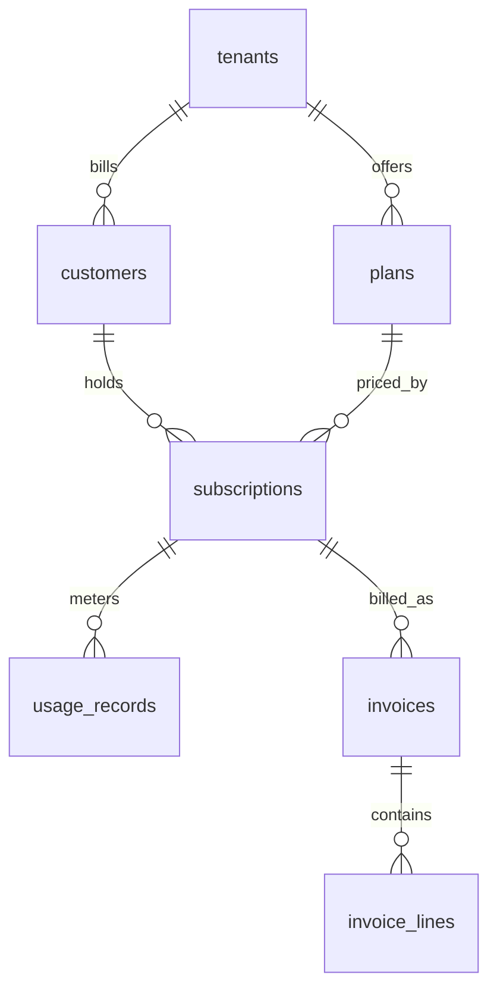

# Architecture

One FastAPI process, server-rendered with Jinja2, SQLite on local disk. One JSON endpoint feeds usage charts. A cron job runs the invoice run per tenant every night.

## Invoice run

## Data model

- Money is integer cents, except `plans.unit_price_cents` (metered price per unit, can be fractional, e.g. 0.04 = $0.0004).
- `plans.amount_cents` is per seat per billing interval (`month` or `year`). `subscriptions.quantity` is seats.
- A subscription is billed on `anchor_day` (1-28) each month, or on `anchor_month`/`anchor_day` once a year. The period is `[run date minus one interval, run date)`.
- "Live" subscriptions are `active` or `past_due`.
- `usage_records.recorded_at` is UTC text, `YYYY-MM-DD HH:MM:SS`; range filters are string comparisons.
- Every query is scoped by `tenant_id`.
- `invoices.fingerprint` arrived in migration 004; invoices issued before it have none.

## Conventions

- One SQLite connection per request (`brookmeter.db.get_conn`), foreign keys on.
- Schema changes are new numbered files in `migrations/`; never edit an applied one.
- Logs: `logs/app.log`, key=value, millisecond timestamps.
- Config: `settings.py`, env overrides `BROOK_*`.

## Tech debt

- No caching layer anywhere.
- No auth in this build (fronted by the SSO proxy in production).
- `seed.py` is the only fixture source; tests use its `test` profile.
