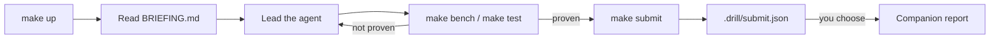

# How it works

## Flow

## Steps

1. `make up` creates `.venv`, installs pinned dependencies, seeds the database and starts the app. It also creates a local git repository in the kit folder and tags the start state `drill-start`.
2. You read `BRIEFING.md`. It is a customer escalation that lists symptoms.
3. You lead your agent. The agent reads code, runs commands and edits files.
4. `make bench` measures each page for each tenant (customer account): time in ms and SQL query count. `make test` runs pytest. Both write their results to `.drill/runs/`.
5. `make submit` collects the session into `.drill/submit.json`.
6. `make reset` returns the kit to `drill-start` and reseeds the data.

## What the kit records

| Source | What | Where |
|---|---|---|
| Claude Code hooks (`.claude/settings.json`) | prompts, tool calls, agent replies, with times | `.drill/session.jsonl` |
| Checkpoints | a git commit after each agent reply; the commit message holds your prompt | kit git history |
| `make bench`, `make test` | results and times | `.drill/runs/` |
| `make record` (other agents) | each shell command in a recorded subshell | `.drill/session.jsonl` |
| `make checkpoint` (other agents) | a git commit on request | kit git history |

## What `submit.json` holds

- Events: prompts, tool calls, runs, with times.
- Commits: message, time and changed files since `drill-start`.
- Runs: bench and test results.
- Diff: the full change since `drill-start`.

The report judges a fix from the diff, not from the agent's statement.
