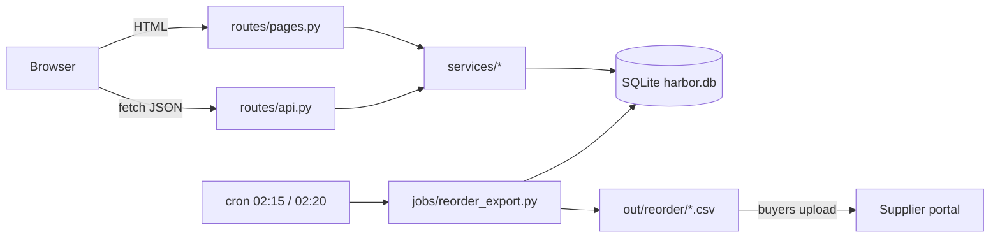
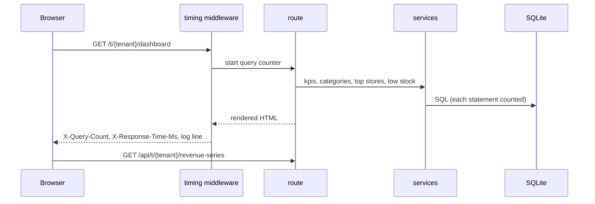
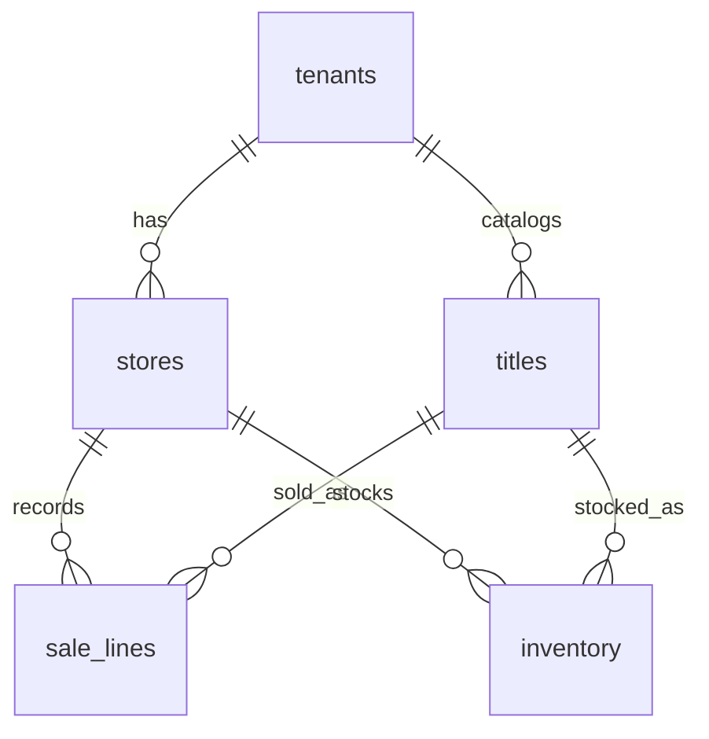

# Architecture

One FastAPI process, server-rendered with Jinja2, SQLite on local disk. Two chart endpoints return JSON. A cron job writes the reorder CSV per tenant every night.

## Request path

## Data model

- Money is integer cents. Net = `qty * unit_price_cents - discount_cents`.
- `sold_at` is local time text, `YYYY-MM-DD HH:MM:SS`; range filters are string comparisons.
- Every query is scoped by `tenant_id` (stores, titles, sale_lines) or through `stores` (inventory).
- `titles.case_pack` arrived with supplier feed v2 (migration 002). Older tenants default to 1.

## Conventions

- One SQLite connection per request (`harbor.db.get_conn`), foreign keys on.
- Schema changes are new numbered files in `migrations/`; never edit an applied one.
- Logs: `logs/app.log`, key=value, millisecond timestamps.
- Config: `settings.py`, env overrides `HARBOR_*`.

## Tech debt

- No caching layer anywhere.
- Charts load Chart.js from a CDN; no offline fallback.
- No auth in this build (fronted by the SSO proxy in production).
- `seed.py` is the only fixture source; tests use its `test` profile.
