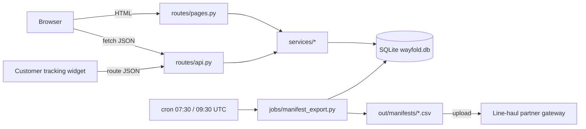
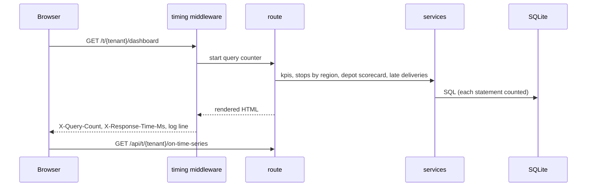
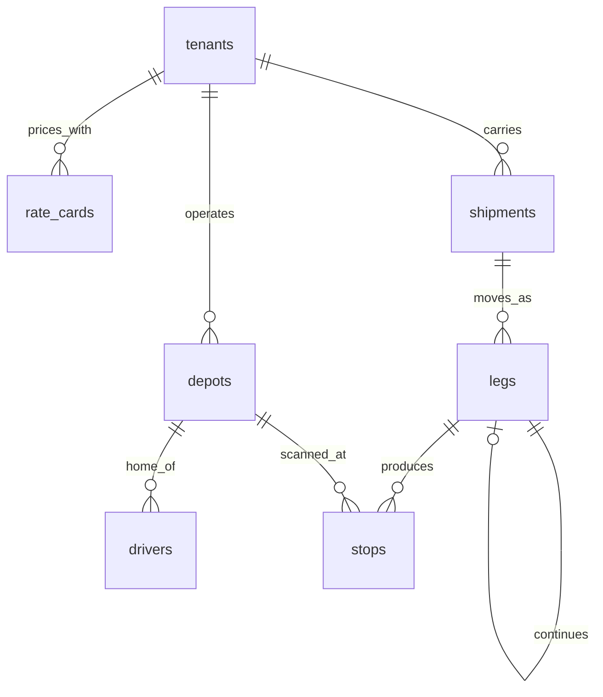

# Architecture

One FastAPI process, server-rendered with Jinja2, SQLite on local disk. Two JSON endpoints: the dashboard's on-time series and the route feed behind the customer tracking widget. A cron job writes the line-haul manifest per tenant every night.

## Request path

## Data model

- A shipment moves as one or more **legs**. Relay legs point at the leg they continue (`parent_leg_id`); the first leg has none. Small carriers run direct, one leg per shipment. Hub carriers run up to three.
- A **stop** is a scan event: `pickup` at the origin, `transfer` at a hub, `delivery` at the destination.
- `stops.arrived_at` and `legs.*_at` come from the driver app and are **UTC**. `stops.window_end` (promised-by) is booked by the customer in the **depot's local wall clock**.
- `tenants.utc_offset_min` is the carrier's home clock. `depots.utc_offset_min` arrived in migration 002 for carriers that span zones. Offsets are fixed (standard time); DST is out of scope for this build.
- `shipments.tendered_on` is the origin depot's calendar day. The manifest picks shipments by this day.
- Rate cards (migration 003) are per tenant and service: `base` per shipment, `per_kg`, `fuel_pct` surcharge. Values are dollars.

## Conventions

- One SQLite connection per request (`wayfold.db.get_conn`), foreign keys on.
- Every query is scoped by `tenant_id`.
- Schema changes are new numbered files in `migrations/`; never edit an applied one.
- Logs: `logs/app.log`, key=value, millisecond timestamps.
- Config: `settings.py`, env overrides `WAYFOLD_*`.

## Tech debt

- The depot scorecard is memoised in-process for large accounts; there is no shared cache and no invalidation on new scans.
- Charts load Chart.js from a CDN; no offline fallback.
- No auth in this build (fronted by the SSO proxy in production).
- `seed.py` is the only fixture source; tests use its `test` profile.
